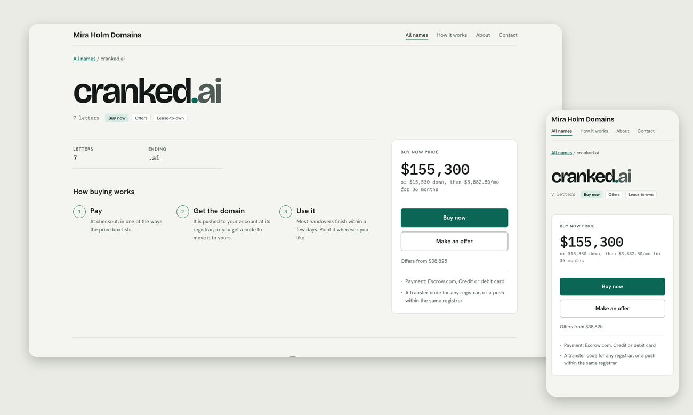
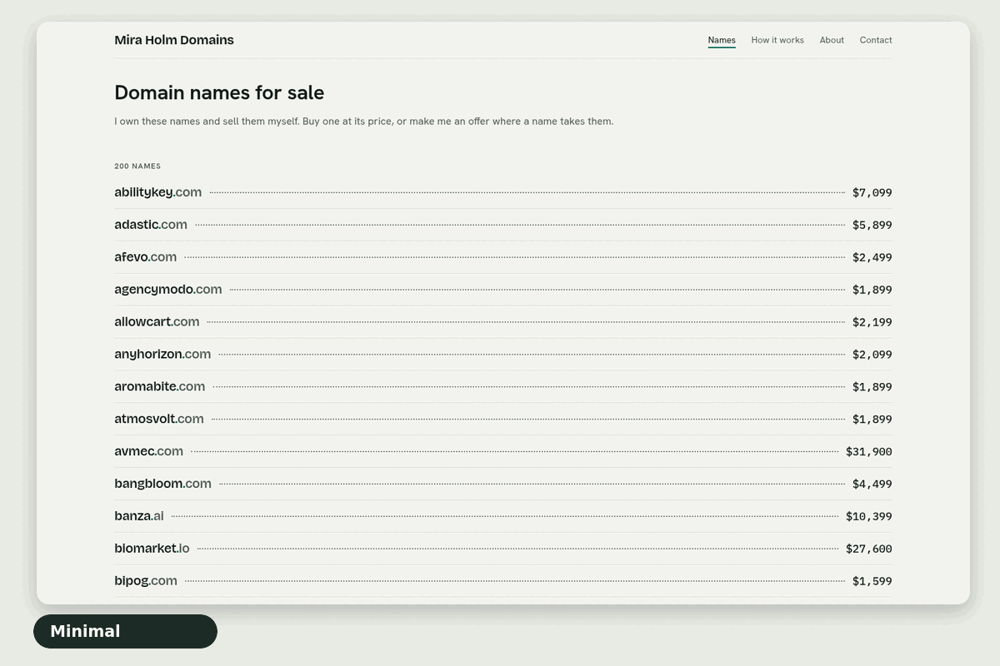
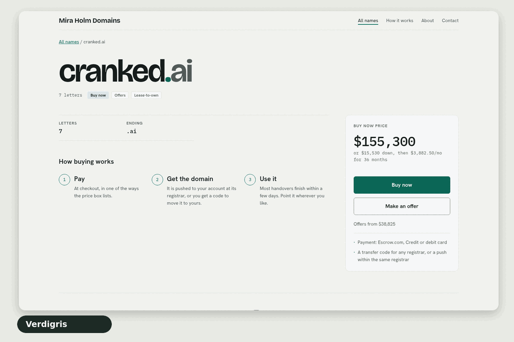
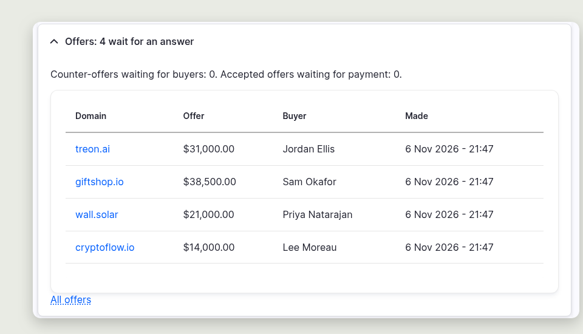

# Domain Investors



Your own site for selling your own domain names. Each domain gets a page with
its price, a **Buy now** button and an offer form; buyers check out, say where
the domain should go, and pay; you hand the domain over from the order. The
site keeps your marketplace listings (Afternic, Sedo, Dynadot and others) in
line with the catalog, reads expiry dates from your registrars, and shows you
offers, sales, profit and expiring domains on a dashboard.

It is a Drupal Commerce site built on
[Commerce Domains](https://www.drupal.org/project/commerce_domains), for one
owner and their own domains: not a marketplace for other sellers. It runs
anywhere Drupal runs, and is set up for [Vallic Cloud](https://docs.vallic.com).

Not technical? [Set it up with Claude](docs/setup-with-claude.md): it does the
work on your own computer, and asks you whenever a decision or a password is yours.

Four templates, from a short price list to a sortable table for thousands of
names, and six colour schemes or your own. A domain can have its own too.

<p>
  
  
</p>

Offers, sales, profit and expiring domains wait for you on the dashboard.



**Get it running**

Locally, with [DDEV](https://ddev.com):

```sh
composer create-project vallic/domain-investors my-portfolio
cd my-portfolio
ddev start
ddev drush site:install domain_investors -y \
  --site-name="My Domains" --account-name=me --account-mail=me@example.com \
  domain_investors_setup.store_email=sales@example.com \
  domain_investors_setup.payments=stripe,paypal,wise,bank_transfer,escrow,lease \
  domain_investors_setup.registrars=dynadot,namecheap \
  domain_investors_setup.marketplaces=afternic,sedo \
  domain_investors_setup.extras=search,meilisearch,eu_invoicing,demo
ddev drush search-api:index
ddev launch $(ddev drush user:login)
```

- Every payment option, two registrars, two marketplaces, search on
  Meilisearch, EU invoicing and [200 demo domains](docs/demo-content.md).
- Keys are samples in `.env`: replace them there, one line each.
- Remove the demo domains before you open your own store.
- Fewer options, or answer in the browser at `/core/install.php`:
  [Install](docs/install.md).


- [Set it up with Claude](docs/setup-with-claude.md): no technical knowledge
  needed
- [Install](docs/install.md): the installer's questions, locally with DDEV
- [Deploy on Vallic Cloud](docs/vallic-cloud.md), and what its caching does
- [Configuration: in git, or on the site](docs/configuration.md)
- [Demo content](docs/demo-content.md): 200 domains to try the site with
- [Automatic updates](docs/automatic-updates.md), with GitHub Actions

**Connect it**

- [Registrars](docs/registrars.md)
- [Marketplaces](docs/marketplaces.md)
- [Parked domains and the lander](docs/parked-domains.md)
- [Payments](docs/payments.md): Stripe, PayPal, Wise, bank transfer, Escrow.com
- [Lease to own](docs/lease-to-own.md)
- [Search on Meilisearch](docs/search.md)

**What you get**

- [The domain catalog](docs/catalog.md), and importing your domains
- [Sale terms](docs/sale-terms.md)
- [The storefront](docs/storefront.md): pages, templates and colours
- [The domain checkout](docs/checkout.md)
- [Handing a domain over](docs/handover.md)
- [Offers](docs/offers.md)
- [Sales and profit](docs/sales-and-profit.md): expenses, renewals, renewal costs
- [The owner dashboard](docs/dashboard.md), and [every day](docs/every-day.md)
- [SEO](docs/seo.md)
- [Mail](docs/mail.md)
- [Sign-in protection](docs/sign-in-protection.md)
- [Buyers' accounts](docs/buyer-accounts.md)

**Reference**

- [Recipes](docs/recipes.md)
- [Variables](docs/variables.md)
- [Keeping secrets out of configuration](docs/secrets.md)
- [Roles](docs/roles.md)
- [Prices in more currencies](docs/currencies.md)
- [The project's files](docs/project-files.md)
- [Checks and tests](docs/checks-and-tests.md)

**License**

GPL-2.0-or-later, like Drupal: see [LICENSE.txt](LICENSE.txt). The Vallic name and
logo aren't covered by it.

---

> <picture>
>   <source media="(prefers-color-scheme: dark)" srcset="docs/images/logo-vallic-reversed.svg">
>   
> </picture>
>
> **Vallic Cloud hosting: Made for this site.** Domain Investors comes ready for Vallic Cloud, with the database, cache and search it needs already set out.
>
> [See Vallic Cloud](https://vallic.com/cloud) · [Prices](https://vallic.com/cloud/pricing)
